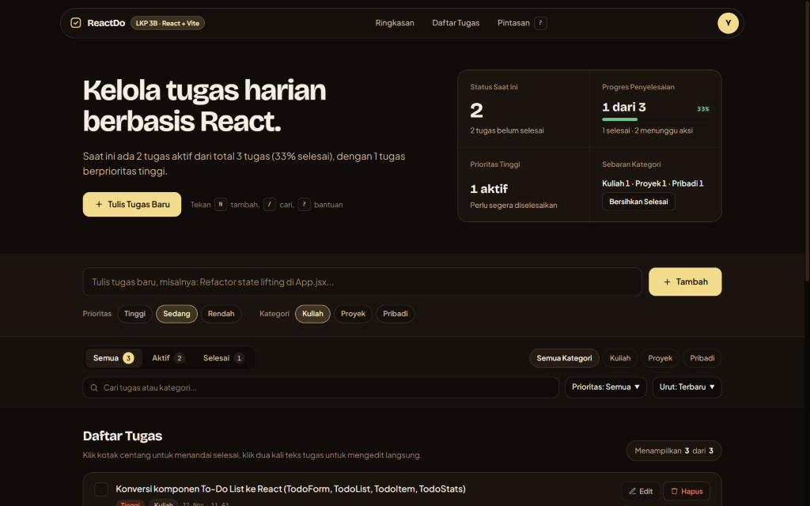
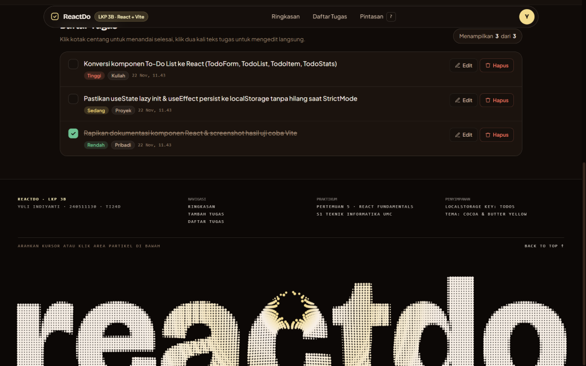
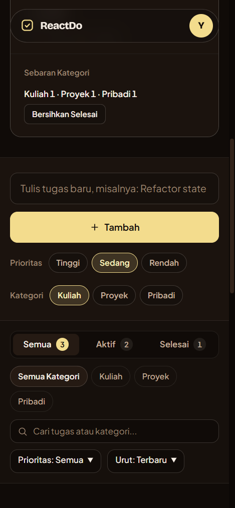

# Tugas 8 — Pemrograman Berbasis Platform (Pertemuan 4 & 5)

**Mahasiswa:** Yuli Indiyanti · **NIM:** `240511130` · **Kelas:** `TI24D`  
**Program Studi:** S1 Teknik Informatika — Universitas Muhammadiyah Cirebon (UMC)  
**Tema Visual:** **Espresso Noir & Butter Yellow (Dark Chocolate × Butter Yellow)** — mengadopsi tipografi editorial (`Bricolage Grotesque` + `Plus Jakarta Sans`), grid hairline 1px, serta **Interactive Halftone Particle Canvas Footer** dari referensi `PPL-MODUL3`.

---

## Ringkasan Proyek

Repositori ini berisi hasil praktikum **Pertemuan 4 (LKP 3A)** dan **Pertemuan 5 (LKP 3B)** yang dibangun dengan desain antarmuka gelap (*Dark Chocolate*) yang seragam, responsif di Desktop/Tablet/Mobile (`1440px`, `768px`, `375px`), serta fitur produktivitas lengkap dengan penyimpanan persisten `localStorage`:

| Pertemuan | Kode LKP | Folder | Teknologi | Wordmark Halftone Footer |
|---|---|---|---|---|
| **Pertemuan 4** — JavaScript Fundamentals & DOM | **LKP 3A** | `lpk-3a/` | HTML5 Semantik, Pure CSS3 (3-Layer Tokens), Vanilla JS ES6+ | `todolist` |
| **Pertemuan 5** — React Fundamentals | **LKP 3B** | `lpk-3b/` | React 19 + Vite 6, Komponen Modular, Hooks (`useState`, `useEffect`, `useMemo`, `useRef`) | `reactdo` |

---

## Fitur Interaktif & Teknis (LKP 3A & LKP 3B)

- **Operasi Wajib Modul + `localStorage`:** Tambah tugas (`#form-todo`, `#input-todo`), tandai selesai dengan checkbox + micro-celebration burst (`.selesai`), hapus tugas (`.hapus`), statistik dinamis (`{belum} tugas belum selesai`), serta persistensi otomatis ke `localStorage` (`"todos"`).
  - Pada **LKP 3B (React)**, state `todos` memakai *lazy initialization* (`useState(() => loadTodos())`) agar `React.StrictMode` tidak menimpa data tersimpan saat mount ganda.
- **Filter, Pencarian, & Pengurutan:** Tab status (`Semua`, `Aktif`, `Selesai`) beserta jumlah real-time, chip kategori (`Kuliah`, `Proyek`, `Pribadi`), filter prioritas (`Tinggi`, `Sedang`, `Rendah`), kolom pencarian live, serta pengurutan (`Terbaru`, `Prioritas`, `A – Z`).
- **Edit Inline & Undo Hapus:** Klik dua kali teks tugas atau klik tombol **Edit** untuk mengedit langsung (`Enter` simpan, `Esc` batal). Menghapus tugas memunculkan **Toast Notifikasi** dengan tombol **Urungkan** (*Undo*) untuk mengembalikan item ke posisi semula.
- **Pintasan Keyboard & Menu Profil:** `N` fokus input tugas baru, `/` fokus kolom pencarian, `?` membuka modal daftar pintasan, `Esc` menutup popover/edit/dialog; plus popover akun (`Y`) untuk memuat 3 contoh tugas atau ekspor JSON.
- **Interactive Halftone Particle Footer (`todolist` & `reactdo`):** Kanvas HTML5 interaktif berbasis partikel halftone yang bereaksi menjauhi kursor sambil menyala hangat warna Butter Yellow (`#F3DC8D`), memancarkan gelombang riak (*shockwave*) saat diklik, dan menyesuaikan ukuran layar secara otomatis.

---

## Pratinjau Tampilan (Verified Screenshots)

### Pertemuan 4 — LKP 3A (`lpk-3a/` · Vanilla JS · Wordmark `todolist`)

<table>
  <tr>
    <td width="50%" align="center">
      <strong>Desktop Workspace (1440×900)</strong><br /><br />
      
    </td>
    <td width="50%" align="center">
      <strong>Halftone Particle Footer (<code>todolist</code>)</strong><br /><br />
      
    </td>
  </tr>
  <tr>
    <td colspan="2" align="center">
      <strong>Mobile Responsive (375×812)</strong><br /><br />
      
    </td>
  </tr>
</table>

### Pertemuan 5 — LKP 3B (`lpk-3b/` · React + Vite · Wordmark `reactdo`)

<table>
  <tr>
    <td width="50%" align="center">
      <strong>Desktop Workspace (1440×900)</strong><br /><br />
      
    </td>
    <td width="50%" align="center">
      <strong>Halftone Particle Footer (<code>reactdo</code>)</strong><br /><br />
      
    </td>
  </tr>
  <tr>
    <td colspan="2" align="center">
      <strong>Mobile Responsive (375×812)</strong><br /><br />
      
    </td>
  </tr>
</table>

---

## Pemenuhan Rubrik Penilaian Modul (100 / 100)

### LKP 3A — To-Do List JavaScript Murni (Pertemuan 4)

| Kriteria | Bobot | Implementasi |
|---|---:|---|
| Fungsi tambah tugas | 20 | Form `#form-todo` & `#input-todo` + pilihan prioritas/kategori + validasi input kosong |
| Fungsi toggle selesai | 20 | Checkbox per item menambahkan class `.selesai`, animasi centang SVG, & micro-celebration |
| Fungsi hapus tugas | 20 | Tombol `.hapus` via event delegation + Toast Undo untuk membatalkan penghapusan |
| `localStorage` | 20 | Persistensi JSON key `"todos"` teruji tetap bertahan setelah reload halaman |
| Kualitas kode & UI | 20 | IIFE modular (`app.js`), sanitasi XSS, token 3 lapis Dark Chocolate (`DESIGN.md`), responsif tanpa overflow |

### LKP 3B — Konversi To-Do List ke React (Pertemuan 5)

| Kriteria | Bobot | Implementasi |
|---|---:|---|
| Struktur komponen | 25 | 9 komponen modular terpisah (`Navbar`, `TodoStats`, `TodoForm`, `TodoToolbar`, `TodoList`, `TodoItem`, `Toast`, `ShortcutModal`, `HalftoneFooter`) |
| Penggunaan props | 20 | Aliran data `App.jsx` → child via props (`todos`, `onTambah`, `onHapus`, `onToggle`, `onEdit`, dll.) |
| `useState` | 20 | State terpusat di `App.jsx` + state lokal di `TodoForm`, `TodoItem` (edit inline), `Navbar` (popover) |
| `useEffect` + `localStorage` | 20 | Lazy initialization + `useEffect` simpan otomatis ke `localStorage`, teruji tahan reload & `StrictMode` |
| UI & kualitas kode | 15 | Zero console error/warning, build produksi Vite bersih, 3-layer CSS tokens, responsif `1440px`/`768px`/`375px` |

---

## Struktur Direktori

```text
tugas 8/
├── DESIGN.md                  # Dokumentasi sistem desain Dark Chocolate × Butter Yellow
├── README.md                  # Dokumentasi proyek & panduan menjalankan
├── lpk-3a/                    # Pertemuan 4: Vanilla JS & DOM
│   ├── index.html
│   ├── style.css
│   ├── app.js
│   └── screenshots/
│       ├── desktop.png
│       ├── footer-halftone.png
│       └── mobile-375.png
└── lpk-3b/                    # Pertemuan 5: React + Vite
    ├── index.html
    ├── package.json
    ├── vite.config.js
    ├── .gitignore
    ├── screenshots/
    │   ├── desktop.png
    │   ├── footer-halftone.png
    │   └── mobile-375.png
    └── src/
        ├── App.jsx
        ├── App.css
        ├── index.css
        ├── main.jsx
        ├── utils/
        │   ├── celebrate.js
        │   └── storage.js
        └── components/
            ├── HalftoneFooter.jsx
            ├── Navbar.jsx
            ├── ShortcutModal.jsx
            ├── Toast.jsx
            ├── TodoForm.jsx
            ├── TodoItem.jsx
            ├── TodoList.jsx
            ├── TodoStats.jsx
            └── TodoToolbar.jsx
```

---

## Cara Menjalankan Proyek

### 1. LKP 3A (Pertemuan 4 — Vanilla JS)
Tidak membutuhkan instalasi paket tambahan:
- Buka langsung file `lpk-3a/index.html` di browser, **atau** jalankan server lokal dari folder `lpk-3a/`:
  ```bash
  npx serve .
  ```

### 2. LKP 3B (Pertemuan 5 — React + Vite)
Masuk ke folder `lpk-3b/`, install dependensi, lalu jalankan server development Vite:
```bash
cd lpk-3b
npm install
npm run dev
```
Untuk membuild versi produksi:
```bash
npm run build
npm run preview
```
